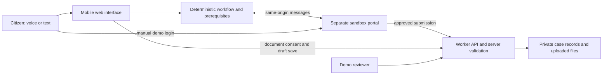

# GramSaathi v2 — working sandbox prototype

A mobile-friendly English/Hindi service-completion prototype with a separate portal, real server validation, stored documents and applications, and citizen approval. It is **not connected to government services** and **does not use an LLM**. Its agent is a deterministic adapter for the sandbox portal.

## Run locally

Node.js 22 or later; no npm dependencies are required.

```sh
npm run build
npm test
npm run dev
```

Open http://localhost:8765. Local records are stored in ignored `.local-storage/`. Hosted storage uses the Sites-provisioned R2 `BUCKET`. Never put real personal information into this prototype.

## Five-minute demonstration

1. Select Agricultural support. The plan identifies a missing income certificate. Explain that this is a fictional dependency, not an official scheme rule.
2. Approve preparation. Answer the questions or use fictional sample details.
3. Choose a synthetic document. Show the extracted fields and consent to upload. The file really is stored in the sandbox backend.
4. Continue to the separate portal. Enter **246810** as the sandbox code, then choose Resume agent.
5. The agent fills actual inputs, waiting for field acknowledgements. Review and approve. The server validates and returns an application reference.
6. Open Demo lab. Request a correction, return to My case, and resolve it. Re-submission retains the application reference and adds a revision.
7. In Demo lab, complete the income review. My case now offers Continue farm application. Existing details are reused; the farm application asks for land area.
8. Submit the farm application. Download receipts and an activity log.
9. Show recovery-file export, saved draft resume, session expiry, and connection failure handling as time allows.

## Architecture



The same-origin iframe is an intentionally cooperating sandbox, not a way to control unrelated government websites. It demonstrates a real integration contract and actual DOM operations. Live automation would require approved service APIs or a controlled browser environment and service-specific compatibility testing.

## Implemented

- Voice input for each question when the browser supports SpeechRecognition; typed fallback and read-aloud.
- English/Hindi main citizen flow and step-wise validation, including Devanagari digit normalization.
- Two distinct linked workflows, conditional prerequisite, and fields reused across the case.
- Consent-gated upload of TXT/PDF/JPG/PNG files up to 2 MB; plain-text field extraction, mismatch warning and citizen-confirmed reuse.
- Separate portal login and post-login handoff, actual input filling with acknowledgements, pause/resume, final review, and renewed review when a portal field changes.
- Backend validation, missing prerequisite rejection, expired-login rejection, and sequential duplicate submission recovery.
- Server-backed cases, reviewer-controlled sandbox status transitions, correction/revision history, receipt and activity downloads.
- Private recovery JSON, operator handoff summary, explicit case/file deletion, and evaluation worksheet.

## Deliberately not claimed

No connected LLM, general browser agent, image/PDF OCR, verified scheme rules, real identity verification, real DigiLocker API, official certificates, government submissions, payment handling or live government status checks. The sandbox's six-digit code is demonstrative, not production authentication. Speech depends on browser support and microphone permission; audio may be processed by the browser's provider. No measured user-study results or benefit approvals are claimed.

## Data and security boundaries

A browser-generated 256-bit private case key scopes API access. It remains in localStorage and can be exported in a recovery file. The recovery file is a bearer credential for fictional test data: anyone holding it can open that case. R2 keys use its SHA-256 hash. Case endpoints reject cross-origin requests; the portal checks message origin and source. User-supplied values are escaped before HTML rendering. Secrets are not needed for this version.

This is suitable for private demonstrations with fictional data, not sensitive production use. Production needs authenticated users, short-lived delegated portal credentials, revocation, rate limiting, transaction-safe concurrent writes, retention policies, encryption/access review and independent security evaluation. R2 read-modify-write records are not transactional; duplicate recovery is tested for sequential retries, not simultaneous requests. Uploaded-file authenticity is not verified. Shared-phone users should delete the fictional case when finished.

## Tests

`npm test` covers the certificate/correction/farm prerequisite cycle, final consent, invalid form values, repeated submission, case isolation, document consent/type-size basics, session expiry, deletion, draft persistence and cross-origin rejection. Browser QA covers the live DOM handoff and receipt journey; speech quality still requires testing on intended phones and accents.

## Suggested user study

Use consenting participants and fictional data. Compare the same sandbox task with and without GramSaathi. Counterbalance task order. Record completion, time, helper interventions, errors, and consent comprehension. The Demo lab downloads an empty CSV worksheet; do not treat automated checks as evidence of rural usability.

## Competition positioning

Claim: a citizen-controlled execution framework that reduces manual steps across linked public-service workflows. Show actual backend outcomes, failure handling and boundaries. The strongest next integration is one authorized service connector, followed by a grounded language-model layer. Preserve deterministic validation and approval gates around any model-generated action.

## Account sign-in and saved progress

The hosted version uses Sites' built-in ChatGPT sign-in. The My account / Save progress button opens an account panel with sign-in, saved applications and sign-out. Signed-in applications are scoped to the platform's stable site-specific user ID, using trusted identity headers provided by the host. Email is displayed in the account panel but is not used as an ownership key. The same account can resume on another browser or phone.

Existing device drafts are linked when the signed-in citizen saves/continues them. Once linked, the device recovery key cannot access that draft without the matching account. Existing account applications are never silently overwritten by an unrelated device draft. Signing out clears the local device key; saved account records remain. A completed answer is saved before moving to the next question.

The login is ChatGPT-based, not mobile OTP. Do not implement or expose a separate authentication endpoint; `/signin-with-chatgpt` and `/signout-with-chatgpt` are host-owned routes. Local preview strips incoming identity headers and stays in device-draft mode; it does not emulate hosted login. The automated worker tests supply trusted identities directly to test authorization and migration. Guest recovery files remain bearer credentials for unlinked fictional cases; account-linked cases instead require sign-in.
